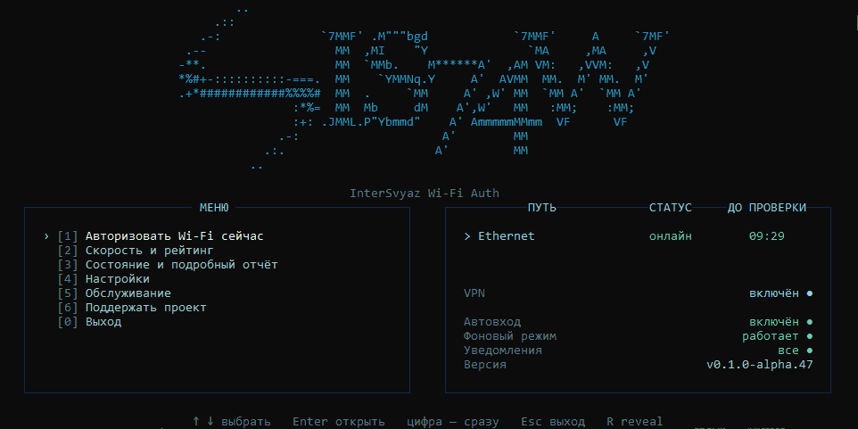

# IS74Wifi — автоматическая авторизация Wi-Fi «Интерсвязь»

**IS74Wifi** — бесплатная экспериментальная утилита для Windows, которая помогает повторно авторизовывать подключение к сети с captive portal «Интерсвязи» без ручного поиска и ввода каждого Wi-Fi-кода.

Проект **неофициальный**: он не разработан, не одобрен и не поддерживается компанией «Интерсвязь». Используйте программу со своей учётной записью и соблюдайте правила сети.



*Главное меню IS74Wifi v0.1.0-alpha.47. Внешний вид последующих выпусков может отличаться.*

## Скачать и установить

**[Скачать IS74Wifi — GitHub Releases](https://github.com/Lomikk/IntersvyazAutomaticWifi/releases)**

Приложение предназначено для **Windows x64** и распространяется в виде одного самодостаточного `IS74Wifi.exe` на C#/.NET 10 NativeAOT: отдельная установка .NET не нужна. Пока это **alpha / pre-release**, поэтому возможны ошибки.

1. На странице Releases откройте нужный выпуск и скачайте из **Assets** файл `IS74Wifi-<версия>-win-x64.exe`. Рядом публикуется файл `.sha256` для проверки контрольной суммы.
2. Запустите EXE. При первом запуске программа предложит **установить себя для текущего пользователя Windows** либо выйти. Установка сама по себе не включает автоматическую авторизацию.
3. Выберите, разрешать ли отправку статистики (**Y/N**). Отказ не мешает использовать программу; решение можно изменить в настройках.
4. Зарегистрируйте устройство: введите свой номер телефона и пройдите предложенное подтверждение. Регистрация сохраняется локально для текущего пользователя Windows.
5. После первоначальной настройки откроется главное меню. Выберите **«Авторизовать Wi-Fi сейчас»** либо **«Настройки → Автоавторизация»** для фоновой работы.

По умолчанию авторизация разрешена только при обнаружении SSID с префиксом `Campus Wi-Fi`. Для нестандартных случаев (USB-раздача, VPN, несколько адаптеров) предусмотрены сетевые настройки; подробности — в [описании прямого сетевого подключения](docs/direct-network.md).

## Возможности

- **Ручная и автоматическая авторизация.** При необходимости приложение получает код через API учётной записи и передаёт его captive portal. Автоматический режим включается отдельно после установки и регистрации.
- **Несколько сетевых путей.** Приложение диагностирует физические адаптеры и умеет направлять запросы через выбранное подключение.
- **Скорость и рейтинг.** Измерение скорости и задержки; публикация результата с ником в публичном рейтинге — отдельное добровольное действие.
- **Диагностика.** Состояние сети, подробный отчёт, журналы, уведомления Windows и значок в трее.
- **Обновление и удаление.** Проверка новых выпусков, ручное или автоматическое обновление с SHA-256 и удаление через меню или список установленных приложений Windows.

В главном меню есть необязательный пункт **«Поддержать проект»**; пожертвования не влияют на доступность функций.

## Основное меню

| Раздел | Назначение |
| --- | --- |
| Авторизовать Wi-Fi сейчас | Разовая попытка авторизации |
| Скорость и рейтинг | Замер качества связи и добровольная публикация |
| Состояние и подробный отчёт | Состояние приложения и сетевых путей |
| Настройки | Автоавторизация, статистика, уведомления, обновления, сеть |
| Обслуживание | Регистрация/сброс устройства, журналы и удаление |

Установленная копия находится в `%LOCALAPPDATA%\Programs\IS74Wifi\IS74Wifi.exe`. Настройки и защищённые Windows DPAPI секреты хранятся отдельно в `%LOCALAPPDATA%\IS74Wifi\`.

Чтобы удалить программу, используйте **«Обслуживание → Удалить программу и данные»** или стандартный список установленных приложений Windows. Первоначально скачанный EXE вне папки установки остаётся пользовательским файлом.

## Статистика и приватность

Перед регистрацией приложение предлагает добровольную отправку статистики. Измерения сначала собираются локально и отправляются отдельно от критического процесса авторизации; при отказе статистика авторизации не отправляется.

Статистика **псевдонимная, а не строго анонимная**: постоянный случайный `install_id` позволяет связать события одной установки. В технический контракт не входят номер телефона, Bearer-токен, коды подтверждения, содержимое push-сообщений, SSID, IP-адреса и MAC/BSSID. Согласие можно отозвать в настройках с очисткой накопленной очереди. Участие в публичном рейтинге регулируется отдельно.

Подробнее: [телеметрия, хранение и передаваемые поля](docs/telemetry.md).

## Безопасность и ограничения

- Для регистрации требуется собственная учётная запись и подтверждение входа. Программа не предоставляет доступа к сети в обход авторизации.
- Запросы с номером телефона и кодом captive portal выполняются через HTTPS. Работа зависит от сети и доступности сервиса.
- SHA-256 позволяет сверить скачанный файл с опубликованной контрольной суммой, **но не заменяет независимую цифровую подпись издателя**. В alpha-сборках возможны предупреждения защиты Windows.
- **Windows 11 может заблокировать неподписанный EXE** через SmartScreen или Smart App Control. Это разные механизмы: SmartScreen часто предлагает «Подробнее → Выполнить в любом случае», а Smart App Control не допускает исключений для одной программы. **Не отключайте защиту без оценки последствий.** [Как распознать блокировку, проверить SHA-256 и действовать при проблеме с обновлением](docs/windows-security.md).
- Не публикуйте Bearer, реальные коды, HAR-файлы с личными данными или содержимое `%LOCALAPPDATA%\IS74Wifi\`.

Сообщить об ошибке можно в [GitHub Issues](https://github.com/Lomikk/IntersvyazAutomaticWifi/issues). Не прикладывайте открытые токены и персональные данные.

## Разработка

Текущий клиент — **C#/.NET 10** (`src/IS74Wifi.App` и `src/IS74Wifi.Core`). Старые PowerShell-скрипты в корне, `experiments/` и `prototypes/` сохранены как reference-реализация и исследования; **не запускайте эксперименты как обычные тесты**, они могут обращаться к реальной сети.

Для локальной проверки на Windows нужны PowerShell 7 и .NET 10 SDK; для полного набора также используются Python и Node.js. Из корня репозитория:

```powershell
# Публичные проверки; приватный backend будет явно пропущен
./scripts/check.ps1 -Mode Full -SkipBackend -Configuration Release
```

Такой запуск **не подтверждает исправность** отдельно развёрнутого приватного сервера.

### Документация проекта

| Документ | Содержание |
| --- | --- |
| [Карта проекта](docs/project-map.md) | Где находится действующая реализация |
| [Проверки](docs/checks.md) | Тестовые команды и их ограничения |
| [Протокол](docs/protocol.md) | Исследованные вызовы API и captive portal |
| [Авторизация по времени](docs/authorization-edge-window.md) | Расписание и пограничные сценарии |
| [Работа с сетью](docs/direct-network.md) | Адаптеры, DNS, VPN и диагностика |
| [Телеметрия](docs/telemetry.md) | Схема статистики и приватность |
| [Измерение скорости](docs/speedtest.md) | Реализация теста скорости |
| [Виртуальная симуляция](docs/virtual-simulation.md) | Изолированные испытания планировщика |
| [Миграция C#](docs/csharp-migration-roadmap.md) | История перехода с PowerShell |
| [Запуск в Windows 11](docs/windows-security.md) | SmartScreen, Smart App Control и SHA-256 |
| [AGENTS.md](AGENTS.md) | Правила работы с кодом |

## Лицензия

Исходный код распространяется по лицензии [MIT](LICENSE). Программа предоставляется **«как есть»**, без гарантий. Названия и товарные знаки сторонних организаций принадлежат их правообладателям.
